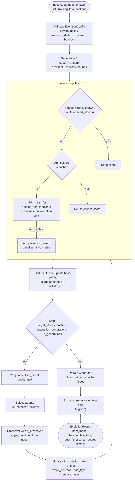

# dnnga — evolve a network's layers and neurons with a genetic algorithm

[](https://github.com/xWuWux/geneticAlgorithm/actions/workflows/ci.yml)

Give it a DNN (or just a list of hidden-layer widths) and some data; it searches
for a better *structure* — more or fewer layers, wider or narrower layers — by
evolving a population of candidate architectures, training each one, and keeping
the fittest.

It is a framework-agnostic rewrite of the thesis experiment *"Optymalizacja
sieci neuronowej za pomocą algorytmów genetycznych"* (`geneticAlgorithm.py` /
the Colab notebook), which also fixes the bugs found while reviewing that code —
see [`docs/CODE_REVIEW.md`](docs/CODE_REVIEW.md).

> **Cost warning.** Every candidate is trained, so a run costs roughly
> `population_size × n_generations` trainings (less with the built-in cache and
> elitism). It is a search tool, not a free lunch.

## How it works

`dnnga` treats a network's **structure** as a genome — the tuple of hidden-layer
widths, e.g. `(64, 32, 16)` — and evolves a population of such genomes. Each
candidate is built, trained briefly and scored on the **validation** split; the
best ones are kept and recombined until a stopping criterion fires. The winner
is optionally retrained with a full budget and scored once on the **test**
split, which is never used for selection.



* **Genotype** — `Architecture((64, 32, 16))`: hidden-layer widths only
  (input/output sizes come from the data). Immutable.
* **Mutation** (with probability `mutation_rate`, exactly one of):
  `tweak_neurons` (width ± up to `neuron_mutation_step`, clamped), `add_layer`
  (random width, random position), `remove_layer`. Operators that are
  infeasible at the current depth are skipped.
* **Fitness** — whatever your backend's `evaluate` returns on the validation
  split; set `direction="minimize"` for losses.
* **Efficiency** — elites are never re-trained; `cache_evaluations` reuses the
  score of an architecture seen before (duplicates become common as the
  population converges); `epochs_per_candidate` is a cheap proxy,
  `final_training_epochs` spends the real budget once.

## Install

```bash
pip install -e ".[sklearn]"         # scikit-learn backend (light, CPU)
pip install -e ".[sklearn,keras]"   # + Keras/TensorFlow backend
pip install -e ".[dev]"             # pytest
```

Needs Python ≥ 3.9 (developed and tested on 3.12 with NumPy 2.5,
scikit-learn 1.9, TensorFlow 2.21 / Keras 3.15). `import dnnga` itself needs
only NumPy; each backend imports its framework lazily.

## Quick start — "a function that takes a DNN and returns a new DNN"

```python
from dnnga import TrainingData, evolve_architecture
from dnnga.backends import KerasMLPBackend   # or SklearnMLPBackend

data = TrainingData(
    X_train, y_train, X_val, y_val,      # candidates are scored + selected on val
    X_test=X_test, y_test=y_test,        # optional: scored once, on the winner only
)
backend = KerasMLPBackend(learning_rate=0.01, random_state=0)

result = evolve_architecture(
    my_model, data, backend,        # a model object, or a plain list such as [64, 32]
    layers_delta=(-1, 2),           # may remove 1 / add 2 layers (relative to my_model)
    neurons_delta=(-8, 16),         # widths from (smallest-8) to (largest+16), floored at 1
    epochs_per_candidate=20,        # how long each candidate trains
    final_training_epochs=100,      # winner is retrained once with a full budget
    population_size=12,
    n_generations=15,
    target_fitness=0.97,            # "train until this accuracy" - stops as soon as it is reached
    return_result=True,             # False (default) returns just the best model
)

result.best_model               # trained model (same framework as the backend)
result.best_architecture        # e.g. Architecture([16, 3])
result.best_fitness, result.test_score   # validation score (optimistic) / held-out score (honest)
print(result.history.summary_text())     # per-generation log; .to_json(path) / .to_csv(path) also exist
```

* **Two ways to bound the search.** Relative to your network (`layers_delta`,
  `neurons_delta`) or absolute (`min_layers=1, max_layers=5, min_neurons=2,
  max_neurons=64`). Combining a delta with the matching absolute bound raises
  `ConfigError`. `neurons_delta` produces one *global* width range for all
  layers; if you meant a per-layer range, use absolute bounds.
  `layers_delta=(0, 0)` fixes the depth and automatically disables the
  add/remove-layer mutations.
* **"Train until a desired accuracy"** is the same function with
  `target_fitness=...`. If you already know your network's score pass
  `seed_fitness=` and it is not re-trained ("I input the current accuracy");
  otherwise it is scored like any candidate.
* **Class API** (more control):
  `GeneticArchitectureSearch(backend, EvolutionConfig(...)).run(data, seed=[16, 8])`.
* **Only the seed's structure is used.** Its weights are not reused: every
  candidate, the seed included, is trained from scratch (unless you supply
  `seed_fitness`, in which case your model object is kept as that individual's
  model).

### Measured examples

From `examples/` — seeds fixed, so numbers may differ slightly across library
versions.

`keras_example.py` — two concentric circles, where a 1-neuron network cannot
succeed; the baseline gets the *same* 80-epoch budget:

```text
your model [1]: val 0.656 | test 0.637 (80 epochs)
evolved [16, 3] (max_generations): val 0.981 | test 0.988 [16 trainings, 20 cache hits]
```

`target_accuracy_example.py` — start from `[2]` on the wine data, stop at 97 %:

```text
starting network [2]: validation accuracy 0.667
stopped because: target_fitness_reached
new architecture: [16] (validation 0.972, held-out test 0.972)
cost: 9 trainings
```

`iris_example.py` — the thesis experiment. Iris is *too easy* to show anything:
generation 0 already contains a candidate at 1.000 validation accuracy. It does
show the selection bias, though: the winner scored 1.000 during the search, and
the same architecture trained properly scores 0.967 on validation and on test.

## Software variables

### `evolve_architecture(seed, data, backend, config=None, **kwargs)`

| Argument | Type | Default | Meaning |
|---|---|---|---|
| `seed` | model, `Architecture` or `list[int]` | — | starting network; only its structure is used |
| `data` | `TrainingData` | — | train / validation (+ optional test) arrays |
| `backend` | `ModelBackend` | — | `SklearnMLPBackend`, `KerasMLPBackend` or your own |
| `config` | `EvolutionConfig` | `EvolutionConfig()` | base settings; keyword arguments override it |
| `seed_fitness` | `float` | `None` | known score of the seed; skips retraining it |
| `layers_delta` | `(int, int)` | `None` | depth range relative to the seed, e.g. `(-1, 2)` |
| `neurons_delta` | `(int, int)` | `None` | width range relative to the seed's smallest / largest layer |
| `return_result` | `bool` | `False` | return the full `EvolutionResult` instead of the model |
| `**config_overrides` | — | — | any `EvolutionConfig` field below |

### `TrainingData`

| Field | Meaning |
|---|---|
| `X_train`, `y_train` | used to train every candidate |
| `X_val`, `y_val` | used to score and **select** candidates |
| `task` | `"classification"` (default) or `"regression"` |
| `X_test`, `y_test` (optional) | scored once, on the winner only → `result.test_score` |

### `EvolutionConfig`

| Field | Type | Default | Original name | Meaning |
|---|---|---|---|---|
| `min_layers` / `max_layers` | `int` | 1 / 6 | `MIN_LAYER` / `MAX_LAYER` | depth range |
| `min_neurons` / `max_neurons` | `int` | 1 / 64 | (fixed 1) / `MAX_NEURONS` | width range, every layer |
| `population_size` | `int` | 20 | `POPULATION` | any integer ≥ 2 |
| `n_generations` | `int` | 20 | `GENERATIONS` | hard cap on generations |
| `epochs_per_candidate` | `int` | 20 | `STEPS`* | training epochs per candidate |
| `final_training_epochs` | `int \| None` | `None` | — | retrain the winner from scratch with this budget |
| `target_fitness` | `float \| None` | `None` | `TARGET_SCORE` | stop when reached (metric's own units) |
| `stagnation_generations` | `int \| None` | 10 | `NO_EVOLVE_GENS` | stop after this many generations without improvement |
| `stagnation_min_delta` | `float` | 1e-4 | — | smallest change that counts as improvement |
| `direction` | `"maximize" \| "minimize"` | `"maximize"` | — | `"minimize"` for loss-like metrics |
| `selection_strategy` | `"tournament" \| "roulette"` | `"tournament"` | (roulette) | parent selection; roulette is scale-sensitive |
| `tournament_size` | `int` | 3 | — | contestants per tournament |
| `elitism_count` | `int` | 1 | — | top-k carried over unchanged, never re-trained |
| `crossover_strategy` | `"single_point" \| "uniform" \| "none"` | `"single_point"` | — | how two parents are combined |
| `p_crossover` | `float` | 0.8 | — | probability a parent pair is crossed over |
| `mutation_rate` | `float` | 0.2 | `MUTATION_CHANCE` | per-individual chance of one mutation |
| `neuron_mutation_step` | `int` | 4 | (always 1) | max width change per tweak |
| `mutation_boundary_mode` | `"clamp" \| "wrap"` | `"clamp"` | (wrap) | `"wrap"` reproduces the original's wrap-around |
| `mutation_operator_weights` | `dict` | tweak .7 / add .15 / remove .15 | — | relative operator frequencies |
| `cache_evaluations` | `bool` | `True` | — | reuse scores of repeated architectures (noisy backends keep one draw) |
| `on_evaluation_error` | `"penalize" \| "raise" \| "skip"` | `"penalize"` | — | what to do when a candidate fails — see below |
| `random_state` | `int \| None` | `None` | — | seeds the GA; seed your backend too for full reproducibility |

\* `STEPS` were estimator gradient *steps*, not epochs — don't copy the number.

### `EvolutionResult` (with `return_result=True`)

| Attribute | Meaning |
|---|---|
| `best_model` | trained winning model (same framework as the backend) |
| `best_architecture` | winning `Architecture`, e.g. `Architecture([16, 3])` |
| `best_fitness` | winner's **validation** score — optimistically biased |
| `test_score` | winner's held-out test score, if a test split was given — report this one |
| `history` | `RunHistory`: per-generation best / mean / worst / best-so-far / trainings / cache hits / failures, `stop_reason`; `.to_json()`, `.to_csv()`, `.summary_text()` |
| `final_population` | last generation's individuals |

## Error handling and logging

* `EvolutionConfig` validates itself and **reports every problem at once**
  (`ConfigError`); it is re-validated at `run()`.
* Seeds outside the search bounds, bad data shapes and unknown keyword arguments
  produce clear errors before any compute is spent.
* A candidate that raises (or returns NaN/inf) is handled per
  `on_evaluation_error`: `"penalize"` logs a warning and gives it the worst
  fitness so the run continues; `"raise"` stops with `EvaluationError`;
  `"skip"` drops it. If *every* candidate fails, the run raises instead of
  returning garbage. `KeyboardInterrupt` is never swallowed. A `train()` that
  forgets to return the model is diagnosed by name.
* Logging uses the standard `logging` module under the name `"dnnga"`; the
  library is silent until you call
  `configure_logging(level=logging.INFO, filepath="run.log")` (`DEBUG` adds
  per-candidate lines).
* `result.history` is structured data (per-generation best / mean / worst /
  best-so-far / trainings / cache hits / failures) with `.to_json()`,
  `.to_csv()` and `.summary_text()`.

## Writing a backend

Subclass `dnnga.backends.ModelBackend` and implement `build`, `train`
(**return the trained model** — Keras' `fit` returns a `History`) and
`evaluate` (finite float on `data.X_val`). `extract_architecture` (to accept
model objects as seeds) and `cleanup` are optional. See `sklearn_backend.py` /
`keras_backend.py`.

An illustrative **PyTorch sketch — not shipped and not tested here**:

```python
class TorchMLPBackend(ModelBackend):
    def __init__(self, lr=1e-2, batch_size=32):
        self.lr, self.bs = lr, batch_size

    def build(self, arch, data):
        layers, prev = [], data.n_features
        for w in arch.layer_sizes:
            layers += [nn.Linear(prev, w), nn.ReLU()]
            prev = w
        return nn.Sequential(*layers, nn.Linear(prev, data.n_outputs))

    def train(self, model, data, epochs):
        X = torch.as_tensor(data.X_train, dtype=torch.float32)
        y = torch.as_tensor(np.searchsorted(np.unique(data.y_train), data.y_train))
        opt = torch.optim.Adam(model.parameters(), lr=self.lr)
        loss = nn.CrossEntropyLoss()
        for _ in range(epochs):
            for idx in torch.randperm(len(X)).split(self.bs):
                opt.zero_grad()
                loss(model(X[idx]), y[idx]).backward()
                opt.step()
        return model

    def evaluate(self, model, data):
        with torch.no_grad():
            out = model(torch.as_tensor(data.X_val, dtype=torch.float32))
        return float((np.unique(data.y_train)[out.argmax(1).numpy()] == data.y_val).mean())
```

## Using it honestly

* **Report `result.test_score`, not `best_fitness`.** The latter is the maximum
  of many validation scores and is biased upward. Keep validation sets big
  enough that one row is not several percentage points.
* **Noise is real.** The same architecture can score very differently run to
  run (thesis Table 3: 23 %–97 %). The cache keeps one draw per architecture;
  for decisions that matter, repeat the search with several `random_state`s.
* **Compare against random search with the same budget:**
  `EvolutionConfig(population_size=N, n_generations=1)` evaluates exactly `N`
  random architectures. If the GA cannot beat that, the structure search is not
  buying you anything on your task.
* Small `epochs_per_candidate` ranks architectures by *how fast they learn*,
  which favours small/shallow ones; use `final_training_epochs` and sanity-check
  the winner with a longer run.

## Limitations (not implemented)

* **Dense stacks only.** The genotype is hidden-layer widths. No
  activation/optimizer/learning-rate/dropout genes, no conv/recurrent/attention
  blocks; `KerasMLPBackend` refuses models containing such layers rather than
  flattening them, and warns that Dropout/BatchNorm are not carried over.
* **No weight inheritance** — every candidate trains from scratch
  (function-preserving "net2net" growth/shrinking would cut cost a lot; a
  bigger project).
* **Sequential evaluation.** No parallelism. (The thesis's "parallel
  computation" claim is not something this code does either. On GPUs, naive
  multiprocessing is usually the wrong tool anyway.)
* **Single objective** (no accuracy-vs-size/latency trade-off), and **no
  PyTorch backend** (sketch above).
* **License: not chosen.** The upstream repository
  (`Francja/geneticAlgorithm`) has none; check with its author before publishing
  derived work.

## Development

```bash
pytest                                  # Keras tests auto-skip without TensorFlow
pytest --cov=dnnga --cov-report=term-missing
python examples/iris_example.py         # also: target_accuracy_example.py, keras_example.py
```

CI (`.github/workflows/ci.yml`) runs the suite on Python 3.9–3.13, a separate
TensorFlow/Keras job with coverage, and a build-and-test-the-wheel job.

Layout: `architecture.py` (genotype) · `config.py` · `operators.py`
(mutation/crossover/selection) · `engine.py` (loop, `evolve_architecture`) ·
`history.py` · `data.py` · `backends/{base,sklearn_backend,keras_backend}.py` ·
`tests/` (`FakeBackend` for engine logic; real training for backends).
